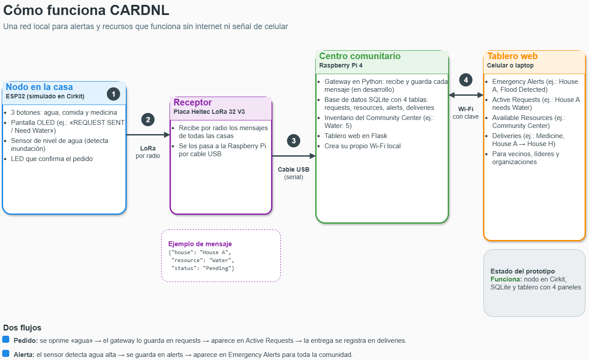

# CARDNL: Coordinador y actualizador de recursos ante desastres naturales

Proyecto final del curso de Internet de las Cosas (IoT).

**Integrantes:** Sophia Peluyera, Cristian Padilla, Ángel López

---

## Problema

En Puerto Rico, los huracanes, terremotos, inundaciones y cortes de luz son parte de la realidad de la población. Durante y después de estos eventos se pierde la señal celular y el acceso a internet, disminuye el acceso a la información y las comunidades no saben qué recursos están disponibles a su alrededor. Las primeras 24 a 72 horas después de un desastre son críticas, y por la situación de la isla ese periodo puede extenderse. En ese tiempo, muchas personas dependen de su propia comunidad como primera respuesta.

La solución beneficia a las comunidades y sus integrantes, a sus líderes y a las organizaciones de manejo de emergencias.

## Solución

CARDNL es un sistema diseñado para coordinar recursos esenciales después de un desastre, sin depender de internet. La propuesta consiste en conectar diferentes viviendas mediante dispositivos IoT que permitan solicitar recursos como agua, comida o medicamentos.

Para demostrar su funcionamiento, desarrollamos un prototipo que combina un nodo ESP32 simulado en Cirkit con un centro de coordinación basado en Raspberry Pi. El nodo permite generar solicitudes mediante botones y alertas utilizando un sensor de nivel de agua.

La Raspberry Pi funciona como centro comunitario y utiliza una base de datos SQLite y un tablero web desarrollado con Flask para almacenar y visualizar las solicitudes.

En una implementación física, los mensajes viajarían mediante LoRa hasta un receptor conectado a la Raspberry Pi. También se propone que el sistema permita mantener actualizado el inventario de recursos, relacionar las solicitudes con las viviendas que pueden ofrecer ayuda y permitir que un voluntario acepte transportar los recursos y confirme la entrega.

La información podría consultarse desde un navegador como Safari o Chrome mediante una red Wi-Fi local creada por la Raspberry Pi, sin necesidad de internet.

Como medida de mejora, se propone registrar el tiempo transcurrido entre una solicitud y su entrega confirmada.

## Componentes

### Nodo de vivienda (simulado en Cirkit)

- **ESP32 DevKit:** microcontrolador principal que procesa las solicitudes y las señales de los componentes conectados.
- **Pantalla OLED 128×64:** muestra las solicitudes y alertas generadas.
- **Tres botones:** permiten solicitar agua, comida o medicamentos.
- **Sensor de nivel de agua:** permite detectar posibles inundaciones y generar alertas.
- **LED rojo:** proporciona una confirmación visual cuando se genera una solicitud.
- **Protoboard y cables:** permiten conectar los componentes del circuito.

### Centro comunitario

- **Raspberry Pi 4:** administra la información del sistema y funciona como centro de coordinación.
- **SQLite:** base de datos utilizada para almacenar solicitudes, recursos y alertas.
- **Flask:** permite desarrollar el tablero web donde se visualiza la información.
- **Script de simulación:** permite representar el envío de solicitudes hacia el centro comunitario sin utilizar todavía una conexión LoRa física.

### Componentes propuestos para una implementación física

- **Heltec WiFi LoRa 32 V3:** permitiría transmitir las solicitudes de las viviendas mediante LoRa.
- **Receptor central LoRa:** recibiría los mensajes enviados desde las viviendas y los transmitiría a la Raspberry Pi mediante USB. Funcionaría como dispositivo intermediario.
- **Baterías de respaldo:** permitirían mantener los dispositivos funcionando durante apagones.

## Diagrama

El archivo editable está en `docs/diagrama/diagrama_CARDNL.drawio` (se abre con draw.io).

## Costo estimado

Para estimar el costo de nuestro proyecto, buscamos los precios de los componentes que necesitaríamos si fuéramos a construir el sistema físicamente. Consultamos tiendas como Rokland, Adafruit, PiShop y Walmart (ver Referencias).

**Es importante aclarar que esta cotización corresponde a una posible implementación física del proyecto y no necesariamente a los gastos de nuestra simulación.** Como inicialmente estamos trabajando con una simulación, no sería necesario comprar todos los materiales mencionados. Sin embargo, incluimos sus precios para tener una idea de cuánto costaría desarrollar el prototipo físico y evaluar su viabilidad fuera del salón.

Los componentes considerados para esta implementación física incluyen alternativas que no forman parte del circuito simulado actualmente, como las placas Heltec con LoRa y los teclados matriciales.

### Desglose de materiales

1. **Heltec WiFi LoRa 32 V3 con antena:** 4 × $29.97 = $119.88 (Rokland).
2. **Raspberry Pi 4 de 4 GB:** $100.00 (PiShop). **Material que el grupo ya tenía.**
3. **Teclado matricial 4×4:** 3 × $5.95 = $17.85 (Adafruit).
4. **Protoboard y cables de conexión:** 3 × $9.95 = $29.85 (Adafruit).
5. **Cable USB-A a USB-C:** 4 × $4.95 = $19.80 (Adafruit).
6. **Tarjeta microSD de 32 GB:** $19.95 (PiShop).
7. **Fuente de alimentación para Raspberry Pi:** $8.95 (PiShop).
8. **Adaptador de alimentación USB:** 3 × $7.95 = $23.85 (Adafruit).

**Costo total estimado:** $340.13.

Como el grupo ya tenía la Raspberry Pi, el gasto adicional para construir el prototipo físico sería de aproximadamente **$240.13 antes de impuestos**, o **$267.74 con el IVU de 11.5 %**, sin incluir el envío. El valor de la Raspberry Pi se estimó utilizando como referencia el modelo de 4 GB, por lo que tendría que ajustarse si el equipo disponible fuera diferente.

Debemos tener en cuenta que estas cantidades no representan lo que estaríamos gastando actualmente en la simulación, sino una estimación de los materiales necesarios para construir el sistema físicamente. Al utilizar herramientas de simulación y componentes que ya tenemos disponibles, el costo real de esta etapa podría ser menor.

### Gastos adicionales para apagones

Si el sistema se implementara físicamente, también tendríamos que considerar fuentes de energía alternativas para mantener los dispositivos funcionando durante una emergencia.

Una opción sería utilizar tres baterías portátiles para las viviendas y una de mayor capacidad para la Raspberry Pi, por un total aproximado de $127.94.

Esto elevaría el valor total estimado de los componentes a unos **$468.07**, sin incluir impuestos ni envío. Antes de utilizarlas, sería necesario verificar su compatibilidad y cuánto tiempo podrían mantener los dispositivos funcionando.

También podríamos considerar paneles solares en el futuro, aunque esto requeriría evaluar los componentes adicionales necesarios para utilizarlos correctamente.

### Gastos recurrentes

El sistema no necesitaría pagos mensuales de internet ni de servicios en la nube para su funcionamiento básico.

Sin embargo, en una implementación física tendríamos que considerar el consumo eléctrico y el mantenimiento de los equipos, incluyendo el reemplazo de baterías, cables o dispositivos que puedan dañarse.

En nuestro caso, trabajar inicialmente mediante una simulación nos permitiría demostrar las funciones principales del sistema sin tener que invertir en todos estos componentes.

### Viabilidad

Consideramos que el proyecto podría ser viable para comunidades que puedan organizarse y trabajar en conjunto con organizaciones de respuesta a emergencias.

Una organización comunitaria podría encargarse de administrar el tablero y coordinar las solicitudes de ayuda entre las diferentes viviendas.

Sin embargo, el costo podría representar una dificultad para algunas familias, especialmente si cada vivienda tuviera que comprar su propio dispositivo. Por eso, una alternativa sería trabajar con municipios u organizaciones comunitarias que puedan encargarse de adquirir y mantener los equipos.

Para implementar el sistema fuera del salón, sería necesario construir los dispositivos físicos, realizar pruebas de comunicación, evaluar el alcance de la señal y establecer una fuente de energía de respaldo.

También tendríamos que considerar la protección de los dispositivos contra las condiciones del tiempo y orientar a los usuarios sobre su funcionamiento.

## Cómo poner en funcionamiento el prototipo

### Nodo de vivienda (simulación en Cirkit)

1. Abrir el proyecto del circuito en Cirkit.
2. Verificar las conexiones del ESP32 DevKit, los tres botones, la pantalla OLED, el sensor de nivel de agua y el LED rojo.
3. Ejecutar la simulación para comprobar el funcionamiento de los componentes.
4. Utilizar los botones para generar solicitudes de agua, comida o medicamentos.
5. Comprobar que la pantalla OLED muestre la información y que el LED funcione como indicador.
6. Probar el sensor de nivel de agua para representar una posible situación de inundación.

### Raspberry Pi

1. Utilizar la Raspberry Pi con Python 3 y las dependencias necesarias para ejecutar el sistema.
2. Iniciar la aplicación desarrollada con Flask.
3. Verificar el funcionamiento de la base de datos SQLite.
4. Abrir el tablero web desde un navegador para visualizar las solicitudes y alertas registradas.
5. Ejecutar el script de simulación de mensajes para comprobar cómo se reciben y registran las solicitudes.

### Comunicación entre dispositivos

Actualmente, la comunicación se representa mediante un script que simula el envío de solicitudes hacia el centro comunitario.

Esto permite realizar pruebas del registro y la visualización de los mensajes sin utilizar todavía dispositivos LoRa físicos.

Para una implementación real, sería necesario configurar los módulos LoRa de las viviendas y conectar un receptor central a la Raspberry Pi.

También se propone configurar la Raspberry Pi como punto de acceso Wi-Fi para permitir que las personas encargadas de coordinar la ayuda consulten el tablero desde sus dispositivos sin depender de internet.

## Pruebas

El prototipo combina un circuito ESP32 simulado en Cirkit con una base de datos SQLite y un tablero web desarrollado con Flask.

La simulación permite representar cómo se generan las solicitudes y las alertas mediante los componentes del nodo.

Por otro lado, el script de simulación permite comprobar el registro y la visualización de los mensajes en el sistema.

La comunicación física mediante LoRa todavía está en desarrollo, por lo que aún sería necesario realizar pruebas para verificar el alcance, la recepción de mensajes y la integración completa entre los dispositivos.

## Seguridad, privacidad y limitaciones

Uno de los riesgos que debemos considerar es que alguien pueda acceder a los mensajes enviados entre las viviendas o generar solicitudes falsas.

Para reducir este problema, proponemos asignar una identificación a cada dispositivo e implementar mecanismos de autenticación y cifrado que permitan proteger los mensajes transmitidos mediante LoRa.

En cuanto a la privacidad, también consideramos utilizar códigos para identificar las viviendas en lugar de nombres personales. De esta manera, se compartiría solamente la información necesaria para coordinar las solicitudes.

Otra medida que queremos incorporar es la confirmación de las entregas por parte de quien transporta el recurso y de quien lo recibe. Esto permitiría llevar un mejor control de las solicitudes completadas.

También sería importante proteger las contraseñas y claves del sistema, evitando incluirlas directamente en los archivos públicos de GitHub.

Estas medidas de seguridad forman parte de las funciones propuestas para el sistema y todavía tendrían que implementarse y evaluarse.

**Limitaciones:** El alcance de LoRa puede verse afectado por la distancia, las montañas y los edificios. Además, esta tecnología está diseñada principalmente para transmitir mensajes cortos.

También debemos considerar la dependencia de la electricidad durante los apagones y que actualmente estamos trabajando principalmente con una simulación.

Por esta razón, todavía no podemos garantizar el funcionamiento completo del sistema entre viviendas reales.

## Presentación

La presentación del proyecto está en `presentacion/`.

## Referencias y créditos

### Ideas y proyectos de referencia

**Meshtastic:** https://meshtastic.org

Sirvió como referencia para la comunicación sin internet mediante LoRa. CARDNL no reproduce directamente Meshtastic, sino que toma como referencia este tipo de comunicación para desarrollar un sistema de coordinación de recursos.

El grupo trabajó en el registro y la visualización de solicitudes y propone incorporar funciones para actualizar el inventario, relacionar las solicitudes con los recursos disponibles, coordinar voluntarios y confirmar las entregas.

**Raspberry Pi:** https://www.raspberrypi.com/tutorials/host-a-hotel-wifi-hotspot/

Documentación utilizada como referencia para la propuesta de crear una red Wi-Fi local mediante la Raspberry Pi.

**Espressif Systems:** https://docs.espressif.com/projects/esp-idf/en/stable/esp32/api-reference/network/esp_now.html

Documentación sobre ESP-NOW, considerada como una alternativa para la comunicación entre dispositivos ESP32.

**Flask:** https://flask.palletsprojects.com/en/stable/

Documentación del framework utilizado para desarrollar el tablero web.

**SQLite:** https://www.sqlite.org/about.html

Documentación del sistema de base de datos utilizado para almacenar la información localmente.

### Herramientas de inteligencia artificial

Se utilizaron herramientas de IA para generar ideas, un primer borrador del diagrama y la estructura de este README. El grupo revisó, modificó y adaptó el contenido final.

### Tiendas consultadas para el costo

**Rokland. (s. f.).** Heltec WiFi LoRa 32 (V3) US915 MHz with optional plastic shell.

https://store.rokland.com/collections/all-active-products/products/heltec-wifi-lora-32v3

**PiShop US. (s. f.).** Raspberry Pi 4 Model B/4GB.

https://www.pishop.us/product/raspberry-pi-4-model-b-4gb/

**Adafruit Industries. (s. f.).** 4x4 Matrix Keypad.

https://www.adafruit.com/product/3844

**Adafruit Industries. (s. f.).** Half Size Breadboard + 78 Piece Jumper Wire Bundle.

https://www.adafruit.com/product/3314

**Adafruit Industries. (s. f.).** USB Type A to Type C Cable.

https://www.adafruit.com/product/4474

**PiShop US. (s. f.).** Raspberry Pi microSD Card, 32GB.

https://www.pishop.us/product/raspberry-pi-sd-card-32gb/

**PiShop US. (s. f.).** USB-C Power Supply, 5.1V 3.0A.

https://www.pishop.us/product/usb-c-power-supply-5-1v-3-0a-black-ul-listed/

**Adafruit Industries. (s. f.).** 5V 2A Switching Power Supply.

https://www.adafruit.com/product/1994

**Walmart. (s. f.).** Anker Power Banks.

https://www.walmart.com/c/brand/anker-mobile-power-packs

## Contribución de cada integrante

- **Sophia Peluyera:** Circuito del nodo en Cirkit, base de datos y tablero en la Raspberry Pi.
- **Cristian Padilla:** Diseño y arquitectura IoT, diagrama, repositorio de GitHub y presentación.
- **Ángel López:** Idea inicial, seguridad, costos, viabilidad y documentación.

